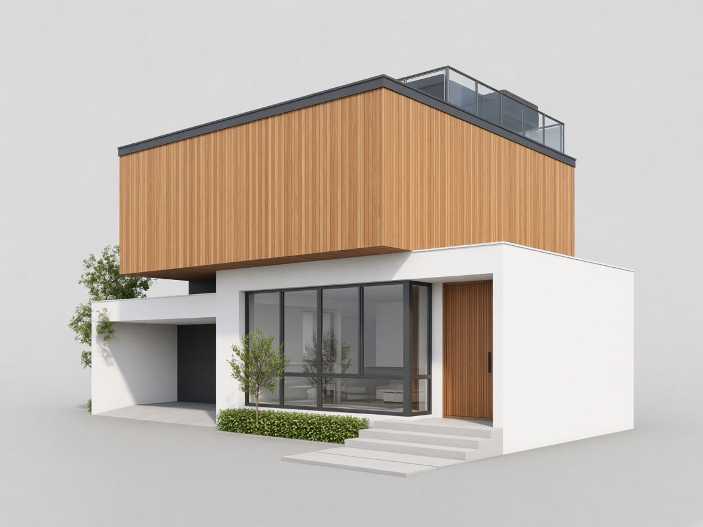
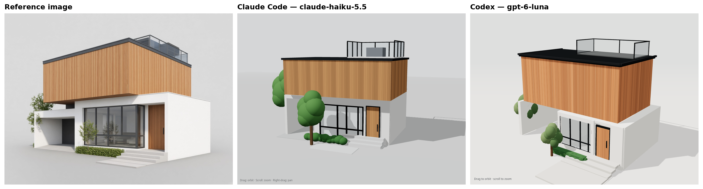

# House 3D: Claude Code vs Codex

**Live side-by-side demo:** https://liyue2055.github.io/house3d-claude-vs-codex/

Two coding agents got the **same prompt** and the **same reference image** and were asked to rebuild the house in Three.js. Each one wrote a single self-contained `index.html` that loads Three.js 0.170 from unpkg through an importmap, with no build step. The 3D code in each folder is entirely the agent's own work. Neither result was edited by hand, and neither agent needed a follow-up fix prompt.

**Live demos (GitHub Pages)**
- Claude Code: https://liyue2055.github.io/house3d-claude-vs-codex/claude-code/
- Codex: https://liyue2055.github.io/house3d-claude-vs-codex/codex/

## Reference image



This is a modern 2-story house:
- a white stucco ground floor with black-framed floor-to-ceiling glazing and a wood-slat front door
- a cedar-clad upper box with a thin dark parapet, cantilevered over a carport and garage on the left
- a rooftop terrace with a glass railing
- concrete steps and a path, a hedge, and two small trees

## Side by side



## Results

| | Claude Code | Codex |
|---|---|---|
| Model (via OpenRouter Ori 0.17) | `anthropic/claude-haiku-5.5` | `openai/gpt-6-luna` |
| CLI | Claude Code 2.1.326 (`-p`, bypass permissions) | Codex CLI 0.169 (`exec`, `-s workspace-write`, image passed with `-i`) |
| Wall time | 161 s (12 turns) | 149 s |
| Tokens | 33.0k output (23.4k thinking), 362k cache-read, 47k cache-write | 48.9k total (as reported by Codex) |
| Cost | $0.030 (as reported by Claude Code) | not printed |
| Output | `index.html`, 353 lines, 14.5 KB | `index.html`, 219 lines, 13.0 KB |
| Console errors (headless Chromium, SwiftShader) | 0 | 0 |
| Follow-up fix prompts | 0 | 0 |
| Importmap + OrbitControls | ✅ | ✅ |
| Procedural wood-slat texture (CanvasTexture) | ✅ | ✅ |
| Soft shadows (PCFSoft) + hemisphere + directional light | ✅ | ✅ |
| Black-framed windows with mullions | ✅ | ✅ |
| Wood-slat door + black handle | ✅ | ✅ |
| Steps + path | ✅ (3 steps + path) | ✅ |
| Rooftop terrace + glass railing | ✅ plus a rooftop bulkhead box (closer to the reference) | ✅ glass panels with physical transmission material |
| Hedge + 2 trees | ✅ | ✅ |
| Cantilever / carport visible from start camera | ⚠️ barely visible: the carport is foreshortened and the garage door is hidden | ⚠️ partly visible as a recessed left bay, but the garage door can't be seen |

### Notes on fidelity
- **Overall look:** both agents captured the main idea, a wood box on a white base with a roof terrace, landscaping and soft shadows. Neither one matched the reference's signature feature. In the image, the wood box is wide and floats over the carport on the left, and the white volume steps forward on the right. Both models put the wood box almost directly on top of the white box.
- **Claude Code:** proportions are boxier and more compact. Its trees are larger and greener than the reference's slim ones. The glazing grid and door are clean and in the right place. The rooftop railing frames are drawn as thick black posts, so they read more as a black fence than as glass. It's the closest of the two to the reference terrace layout, including the bulkhead. The camera is near the reference 3/4 view but a little more frontal.
- **Codex:** the wood box is more convincing in scale and grain, and the glass railing reads as real glass. Its camera is higher, and the black roof cap is much thicker than the thin parapet in the reference. The windows and door are smaller relative to the facade, and the white base looks pushed back under the box rather than stepping forward.
- **Code quality:** both files are tidy single-file modules with small helper functions (`box`, `tree`, `railing`/`bar`, a wood-texture generator) and a resize handler. Claude's file is longer and more parameterized. Codex's file is more compact.

## Reproduce / view locally

```bash
git clone https://github.com/liyue2055/house3d-claude-vs-codex.git
cd house3d-claude-vs-codex
python3 -m http.server 8000
# open http://localhost:8000/claude-code/  and  http://localhost:8000/codex/
```
The files need to be served over HTTP. ES modules don't load from `file://`.

Each folder contains:
- `index.html`: the agent's output
- `reference.jpg`: the image it was given
- `screenshot.png`: a headless Chromium render at 1024×768
- `AGENT_LOG.txt`: the prompt, the command, timing, token usage, and the agent's full redacted stdout

## Prompt (identical for both)
See the `=== PROMPT ===` section in [claude-code/AGENT_LOG.txt](claude-code/AGENT_LOG.txt).
